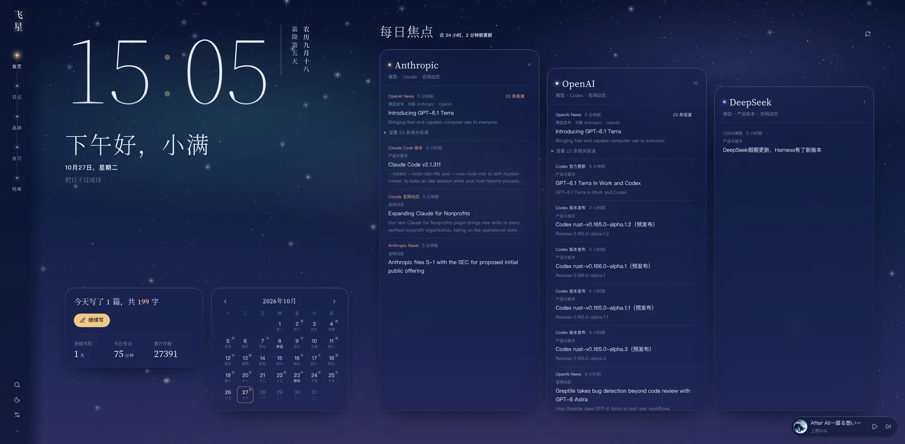
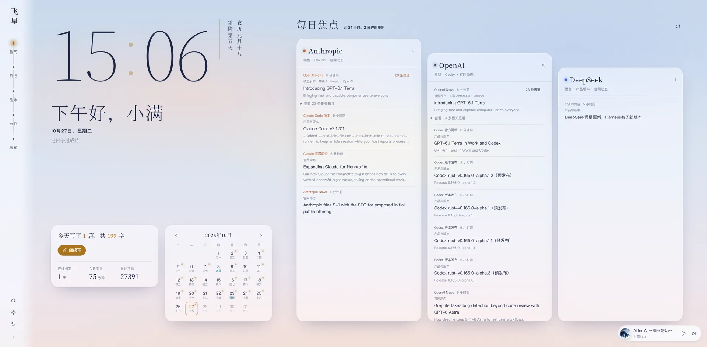
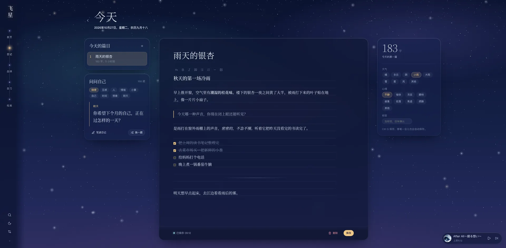
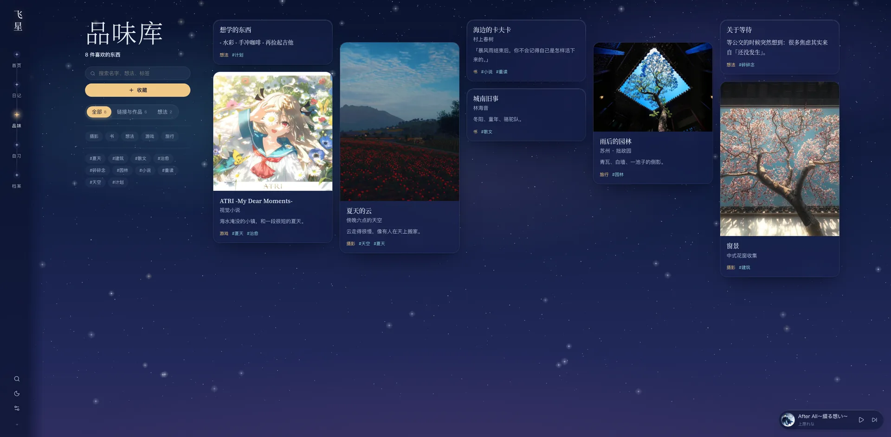
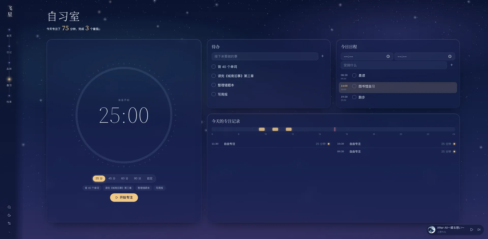
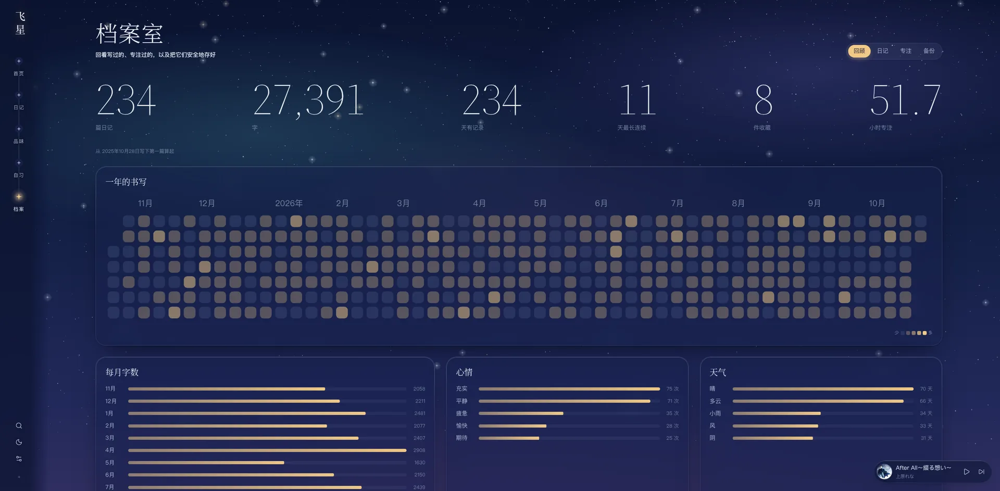
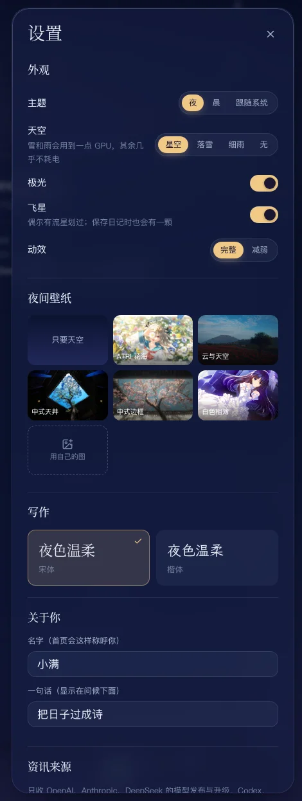

# 星痕

一个只在自己电脑上运行的日记与生活空间。写日记、收藏喜欢的东西、专注自习、听本地音乐、看 AI 圈当天的新闻，都在浏览器里一个页面完成。数据全部存在本机，不注册、不上云。



- **只在本机**：服务只监听 `127.0.0.1`，局域网里的其他设备也访问不到
- **登录即可用**：设成自动启动后，打开浏览器访问 <http://127.0.0.1:8001> 就能写
- **轻**：一个 Node 进程，常驻一百多 MB 内存，空闲时几乎不占 CPU

> 截图里的日记、收藏和专注记录都是演示数据。

## 安装

### 1. 装好 Node.js 23.6 或更新的版本，以及 git

```bash
# Arch / CachyOS / Manjaro
sudo pacman -S nodejs pnpm git
```

```bash
# Ubuntu / Debian（系统自带的 Node 太旧，用 NodeSource 装新版）
curl -fsSL https://deb.nodesource.com/setup_24.x | sudo -E bash -
sudo apt install -y nodejs git
```

其他发行版装好后运行 `node -v`，看到 `v23.6` 或更高就行。pnpm 可装可不装，没有的话会自动改用 npm。

### 2. 下载并启动

```bash
git clone https://github.com/Pasitearko/xinghen.git
cd xinghen
./feixing
```

第一次运行会自动安装依赖、构建网页、在后台启动服务，然后打开浏览器。之后想打开，再运行一次 `./feixing` 就行。

### 3. 设成登录后自动启动（推荐）

```bash
./feixing install
```

以后每次登录桌面，星痕都会在后台自动启动，直接在浏览器打开 <http://127.0.0.1:8001> 即可。建议把它加成书签或设为主页。应用菜单里也会多一个「飞星」图标。

### 更新与卸载

```bash
git pull && ./feixing restart     # 更新到最新版
./feixing uninstall               # 取消自动启动
```

要彻底卸载，先运行 `./feixing uninstall`，再删掉代码文件夹即可。日记等数据在 `~/.local/share/feixing/`，不会随代码一起删除；确定不要了再手动删掉它。

## 功能

### 首页



打开就能看到今天的全部概况：

- **时钟与问候**：按时段问候，下面是日期、自己设的一句话，旁边竖排写着农历和节气
- **今天**：今天写了几篇、多少字，一键继续写；连续书写天数、今日专注分钟数、累计字数
- **日历**：写过日记的日子带小圆点，标出农历和节气，点哪天就跳到那天的日记
- **那年今日**：往年的同一天写过日记的话，会在这里翻出来
- **每日焦点**：Anthropic、OpenAI、DeepSeek 三家各一列，详见下面的[每日焦点](#每日焦点)
- **夜与晨两套主题**：手动切换，或跟随系统的深浅色；切换时有过渡动画

### 日记



书桌分三栏：左边是今天的篇目和灵感题，中间是信纸，右边记字数、天气、心情和标签。

- **只有今天可写**：一天可以写好几篇；过去的日子自动封存为只读，用左右箭头在写过的日子之间翻看
- **所见即所得**：粗体、斜体、标题、引用、列表、待办、分隔线和图片写下去就直接显示效果；光标移到那一行时才露出 Markdown 符号，方便修改。存下来仍是纯 Markdown
- **不丢稿**：停笔片刻自动保存，`Ctrl S` 立即保存；草稿在浏览器里另存一份，断电、关标签页都不丢。两个标签页同时编辑不会互相覆盖
- **图片**：直接粘贴或拖进信纸，上传前会在浏览器里自动压缩
- **问问自己**：写不出来的时候，从 168 道灵感题里抽一题，分为五感、人、情绪、小事、自己、时间、想象、明天八个方向。一键「写进日记」，题目会作为引用插到正文末尾
- **字体**：信纸可选宋体或楷体

### 品味库



收藏让你停下来的东西：书、电影、音乐、游戏、风景，或者一闪而过的想法。

- 两种收藏：**链接与作品**（标题、作者或出处、链接、多张图片）和**想法**（一段支持 Markdown 的文字）
- 自由填写分类和标签，左侧按分类、标签筛选，也可以搜索名字、想法和标签
- 瀑布流排布；图片可直接粘贴，第一张作为封面。网格里只加载小图，滚动很顺

### 自习室



- **番茄钟**：25、45、60、90 分钟或自定义时长；开始前可以绑定一条待办，完成后记到它名下
- **待办**：写下接下来要做的事，勾选完成
- **今日日程**：按时间段安排今天，当前时段会高亮
- **专注记录**：一条 6 点到 24 点的时间轴，标出今天每一次专注；顶部汇总今天专注了多少分钟、完成几个番茄

### 档案室



回看写过的、专注过的，并把它们安全地存好。分四个栏目：

- **回顾**：总篇数、总字数、记录天数、最长连续、收藏数、专注小时数；一年的书写热力图；每月字数、心情和天气统计
- **日记**：全部日记按时间列出，可以全文搜索
- **专注**：每天的专注分钟数趋势
- **备份**：每天第一次启动时自动备份一份，保留最近 7 份；也可以随时手动导出。备份 zip 里是完整数据和全部图片，在另一台电脑上导入即可恢复，详见[导入与迁移](#导入与迁移)

### 本地音乐


右下角的迷你播放器在任何页面都在，点开是完整的播放器：旋转的唱片、滚动歌词、歌单、循环与随机播放。

- 支持 mp3、flac、m4a、ogg、opus、wav
- 标题、歌手、封面优先读取文件内嵌的标签（ID3v2 / FLAC）；没有标签就按文件名「歌手 - 曲名」来猜
- 同名的 `.lrc` 文件作为歌词，双语歌词（原文和翻译分两行，或同一时间戳）都能识别；UTF-8、UTF-16、GBK 编码都行
- **封面**：在音乐文件夹里放一张 `封面.jpg`（png、webp 也行），所有歌曲就统一使用它；没有的话，依次找内嵌封面、和歌曲同名的图片、文件夹里的 `cover.jpg` / `folder.jpg`
- 键盘媒体键和桌面的媒体控件（MPRIS）都能控制播放
- 曲库扫描在后台进行，只重新读新增或改过的文件，曲库再大也不会拖慢写日记

**添加歌曲**：把音乐文件放进 `~/.local/share/feixing/music/`，然后在歌单里点「重新扫描」。已有音乐目录（比如 `~/Music`）的话，在[配置](#配置)里用 `FEIXING_MUSIC_DIR` 指过去即可。

<br clear="right">

### 每日焦点

首页的资讯只追三家：**Anthropic、OpenAI、DeepSeek**。只收这几类消息：

- 三家的模型发布与模型升级
- Codex、Claude、DeepSeek 的产品与版本更新
- 三家官网发布的原文

融资、人物访谈、评测、教程和传闻一律不收。

- **只看最近 24 小时**：每 3 小时自动更新一次，开机时离上次更新超过 3 小时也会补一次；超过 36 小时的条目直接删除，不留历史
- **同一件事合成一条**：多家媒体报道同一件事时只显示一条，有官方原文就优先显示原文，标出共有几条报道，点开能看到全部相关报道。同一个模型的首发、后续升级和不同版本会分开判断
- **按热度排序**：报道越多越靠前，官方发布再加一档，随时间慢慢降温；每列最多 12 条
- **只写了日期的官方文章**（比如 OpenAI 的 RSS）按本机第一次看到它的时间算，不会被当成当天 0 点发布而漏掉
- 在「设置 → 资讯来源」里可以单独开关每个来源

| 分类 | 来源 |
| --- | --- |
| 官方 | OpenAI News 与 API 更新日志、Codex 官方更新与 GitHub Releases、Anthropic News、Claude 产品更新与官网文章、Claude Platform 更新、Claude Code Releases、DeepSeek 官网与 API 更新日志、Hugging Face 上 deepseek-ai 和 openai 发布的新模型 |
| 媒体 | 量子位、雷峰网、爱范儿、IT之家、cnBeta、InfoQ 中文、The Verge、TechCrunch、The Decoder |
| 社区 | Hacker News（80 分以上）、Simon Willison |
| 聚合 | Google 新闻，按公司名搜索最近一天的报道 |

所有来源都是公开页面，星痕只读取，不发送任何私人数据。需要代理才能访问的话，在[配置](#配置)里写上 `HTTPS_PROXY`。

### 设置与外观



点侧栏底部的滑杆图标打开设置：

- **主题**：夜、晨，或跟随系统
- **天空**：星空、落雪、细雨或什么都不要；可以再加一层极光；偶尔有流星划过，保存日记时也会飞过一颗
- **动效**：完整或减弱；系统开启了「减少动态效果」时会自动减弱
- **壁纸**：夜间和晨间各选一张，内置几张，也可以上传自己的图
- **写作字体**：宋体或楷体
- **关于你**：名字和一句话，首页的问候会用到
- **资讯来源**、**音乐目录**

其他小细节：

- **`Ctrl K` 全局搜索**：在一个框里搜日记和收藏，或者直接跳到某个栏目
- **适配大屏**：按 2560 宽的显示器设计，首页一屏放下时钟、今天、日历和三列资讯；窄屏和手机上自动收成单栏
- **加载快**：每个页面按需加载，鼠标停在导航上时就开始预加载

<br clear="right">

## 技术栈

整个应用是**一个 Node 进程**：同一个端口既提供网页，也提供接口。不需要单独的数据库服务，也没有任何需要编译的原生模块。

| 部分 | 用了什么 | 说明 |
| --- | --- | --- |
| 运行时 | [Node.js](https://nodejs.org) 23.6+ | 直接运行 TypeScript 源码，不需要编译步骤 |
| 数据库 | `node:sqlite`（Node 内置的 SQLite） | 一个 `feixing.db` 文件，WAL 模式 |
| 后端 | `node:http` + 自己写的小路由 | 没有 Express 之类的框架；静态文件预压缩成 Brotli / Gzip 放在内存里 |
| 备份 | [fflate](https://github.com/101arrowz/fflate) | 在 Worker 线程里打包 zip，导出时不卡界面；也是唯一的运行时依赖 |
| 前端 | [React 19](https://react.dev) + [Vite](https://vite.dev) | 路由用 [wouter](https://github.com/molefrog/wouter)，数据请求与缓存用 [TanStack Query](https://tanstack.com/query) |
| 编辑器 | [CodeMirror 6](https://codemirror.net) | 自己写的实时预览插件，让 Markdown 边写边显示效果 |
| 动效 | [Motion](https://motion.dev) | 页面切换、共享元素展开、数字滚动等 |
| 图标 | [Lucide](https://lucide.dev) | |
| 字体 | Source Serif 4 + 思源宋体 | 西文和数字用 Source Serif 4，中文用系统里的思源宋体（Noto Serif CJK） |
| 后台服务 | systemd 用户服务 | `./feixing install` 生成，服务意外退出时自动重启 |
| 开发 | TypeScript、`node:test` | `pnpm check` 类型检查，`pnpm test` 跑测试 |

安全方面：服务只监听 `127.0.0.1`，写请求只接受本机页面发来的，其他网站没法偷偷调用接口。

## 数据放在哪

遵循 XDG 规范，代码目录里不存任何私人数据：

```
~/.local/share/feixing/
├── feixing.db        日记、收藏、自习记录、个人资料（SQLite）
├── uploads/          图片附件
├── backups/          自动备份和手动导出的 zip
├── music/            默认的音乐文件夹
└── music-index.json  曲库索引（删掉也没关系，下次会重新扫描）
```

想整个搬家的话，先 `./feixing stop`，再把这个文件夹拷走。

### 导入与迁移

导入都是**合并导入**：已有的内容不会重复，也不会被覆盖，可以放心多导几次。

- **备份 zip（推荐）**：在旧电脑的「档案室 → 备份」导出 zip，拷到新电脑后，在「档案室 → 备份 → 导入与迁移」里选择这个文件，先看预览再确认
- **整个数据文件夹**：把旧的数据文件夹（里面有 `feixing.db` 和 `uploads/`）拷过来，然后：

  ```bash
  ./feixing import ~/下载/feixing --dry   # 先预览，不写入
  ./feixing import ~/下载/feixing
  ```

更早的 JSON 导出也能导入，里面内联的 base64 图片会自动存成本机文件。

## 配置

配置文件是 `~/.config/feixing/env`（`./feixing install` 时自动生成，也可以自己创建）。每行一个 `KEY=VALUE`，去掉行首的 `#` 即生效，改完运行 `./feixing restart`：

```ini
FEIXING_PORT=8001                    # 端口
FEIXING_MUSIC_DIR=/home/你/Music      # 音乐目录
FEIXING_DATA_DIR=/home/你/.local/share/feixing
FEIXING_TZ=Asia/Shanghai             # 「今天」按哪个时区算，默认跟随系统
HTTPS_PROXY=http://127.0.0.1:7890    # 抓资讯用的代理
```

## 常用命令

| 命令 | 作用 |
| --- | --- |
| `./feixing` | 没启动就启动，然后打开浏览器 |
| `./feixing start` / `stop` / `restart` | 后台启动、停止、重启 |
| `./feixing status` | 是否在运行，数据、音乐、备份各放在哪 |
| `./feixing logs` | 查看日志 |
| `./feixing build` | 重新构建网页（改了源码后 `start` 也会自动构建） |
| `./feixing import <路径>` | 导入数据，加 `--dry` 只预览不写入 |
| `./feixing install` | 登录后自动启动，并加到应用菜单 |
| `./feixing uninstall` | 取消自动启动（不删数据） |
| `./feixing dev` | 开发模式，Vite 热更新在 <http://127.0.0.1:5199> |

## 开发

```bash
pnpm install
pnpm dev        # 后端 8001 + Vite 5199，改代码即时生效
pnpm check      # TypeScript 类型检查
pnpm test       # 备份、导入与资讯规则的测试
```

```
server/            后端
├── main.ts        入口：启动 HTTP 服务、定时任务
├── db.ts          SQLite 表结构与查询工具
├── routes/        接口，每个文件对应一组（日记、收藏、自习、音乐……）
├── news*.ts       每日焦点：来源、解析、合并规则
└── test/          测试
web/src/           前端
├── pages/         各个页面
├── components/    公共组件（侧栏、播放器、设置……）
├── lib/           状态、接口、日期等工具
└── styles/        全局样式与主题
```

## 致谢

- 动效参考了 [React Bits](https://github.com/DavidHDev/react-bits)（MIT）和 [starc007/ui-components](https://github.com/starc007/ui-components) 的思路：滑动选项卡、数字滚动、弹性勾选、共享元素展开、聚光灯悬停等，均按本项目的风格重写。
- 西文与数字用 [Source Serif 4](https://github.com/adobe-fonts/source-serif)（SIL OFL 1.1，许可见 `web/src/styles/fonts/`），中文用系统里的思源宋体（Noto Serif CJK），两者是同一家族的姊妹字体。
- 图标来自 [Lucide](https://lucide.dev)（ISC），动画库是 [Motion](https://motion.dev)（MIT），日记编辑器基于 [CodeMirror 6](https://codemirror.net)（MIT）。
- `web/wallpapers/` 里的壁纸收集自网络，版权归原作者所有，仅作个人非商业使用。如果其中有你的作品且不希望出现在这里，请发邮件到 jiuliyearli@gmail.com 或提 Issue，确认后会尽快删除。
